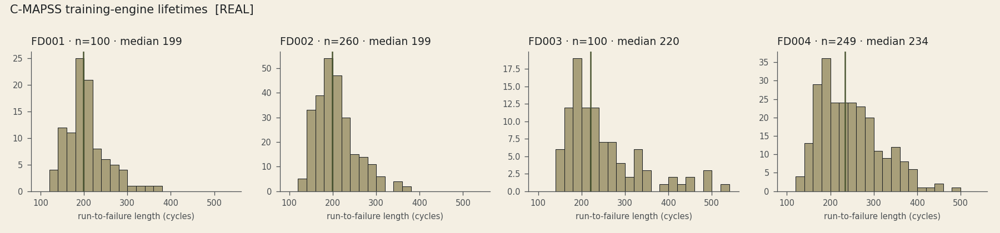
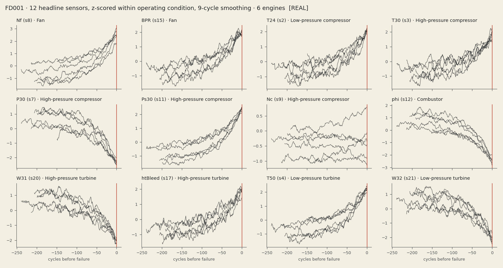
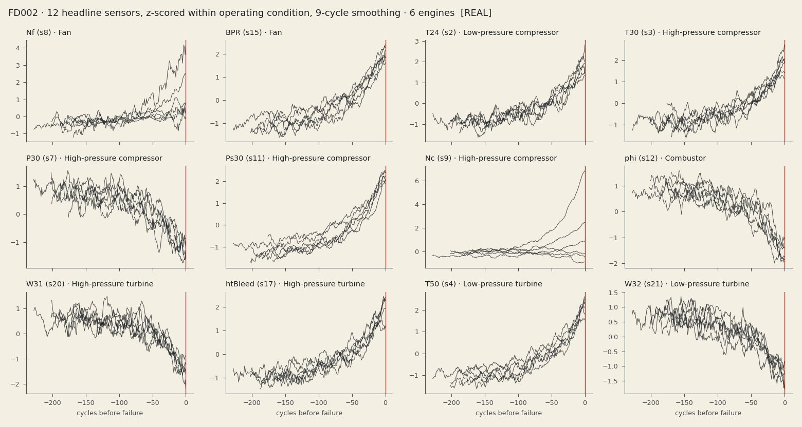
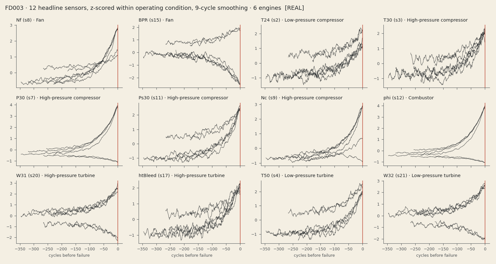
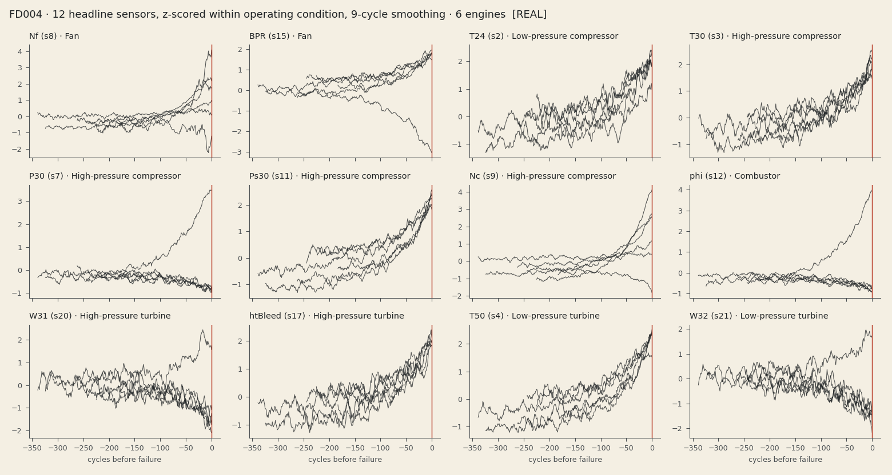

# DATA NOTES — NASA C-MAPSS  `REAL`

_Generated by `python -m pratirakshak.ingest` from the files on disk. Do not edit by hand._

Source folder: `data/raw/cmapss/CMAPSSData`. Columns per file: **26** (`unit, cycle, op1–op3, s1–s21`), whitespace-separated with trailing spaces.

## 1. Counts vs SPEC §3.2 and readme.txt

| Subset | Train engines | Test engines | RUL lines | Train rows | Test rows | SPEC (train/test, rows) | readme (train/test) | Match |
|---|---|---|---|---|---|---|---|---|
| FD001 | 100 | 100 | 100 | 20,631 | 13,096 | 100/100, 20,631 | 100/100 | SPEC: yes · readme: yes |
| FD002 | 260 | 259 | 259 | 53,759 | 33,991 | 260/259, 53,759 | 260/259 | SPEC: yes · readme: yes |
| FD003 | 100 | 100 | 100 | 24,720 | 16,596 | 100/100, 24,720 | 100/100 | SPEC: yes · readme: yes |
| FD004 | 249 | 248 | 248 | 61,249 | 41,214 | 249/248, 61,249 | 248/249 | SPEC: yes · readme: **no** |

- **FD004:** readme says 248/249
- Resolution: the files are the source of truth (SPEC §3.2).

## 2. Operating conditions

Conditions are discrete points in (altitude, Mach, TRA) space. Coarse labels (rounded settings) used for EDA only; model pre-processing fits KMeans(k=6) on training units (Stage 3).

| Subset | Distinct conditions (train) |
|---|---|
| FD001 | 1 |
| FD002 | 6 |
| FD003 | 1 |
| FD004 | 6 |

## 3. Constant / uninformative sensors (determined empirically)

Rule: a sensor is **constant** in a subset if it takes **≤ 2 distinct values within every operating condition** on the training engines. Relative standard deviation is *not* used: e.g. Nf (s8) varies by only ~10⁻⁵ relative yet trends clearly with degradation. The Spearman correlation of each sensor (z-scored within condition) with capped RUL (min(RUL,125)) is listed as an informativeness signal.

| Subset | Constant sensors |
|---|---|
| FD001 | s1 (T2), s5 (P2), s6 (P15), s10 (EPR), s16 (farB), s18 (Nf_dmd), s19 (PCNfR_dmd) |
| FD002 | s1 (T2), s5 (P2), s10 (EPR), s16 (farB), s18 (Nf_dmd), s19 (PCNfR_dmd) |
| FD003 | s1 (T2), s5 (P2), s16 (farB), s18 (Nf_dmd), s19 (PCNfR_dmd) |
| FD004 | s1 (T2), s5 (P2), s16 (farB), s18 (Nf_dmd), s19 (PCNfR_dmd) |

Spearman ρ with capped RUL (negative = rises as the engine wears; blank = constant):

| Sensor | Symbol | Headline part | FD001 | FD002 | FD003 | FD004 |
|---|---|---|---|---|---|---|
| s1 | T2 | — |  |  |  |  |
| s2 | T24 | Low-pressure compressor | -0.63 | -0.59 | -0.64 | -0.54 |
| s3 | T30 | High-pressure compressor | -0.61 | -0.58 | -0.66 | -0.61 |
| s4 | T50 | Low-pressure turbine | -0.70 | -0.69 | -0.71 | -0.67 |
| s5 | P2 | — |  |  |  |  |
| s6 | P15 | — |  | -0.36 | -0.18 | -0.20 |
| s7 | P30 | High-pressure compressor | +0.68 | +0.48 | -0.04 | -0.11 |
| s8 | Nf | Fan | -0.57 | -0.39 | -0.71 | -0.53 |
| s9 | Nc | High-pressure compressor | -0.33 | -0.29 | -0.56 | -0.52 |
| s10 | EPR | — |  |  | -0.46 | -0.22 |
| s11 | Ps30 | High-pressure compressor | -0.72 | -0.71 | -0.74 | -0.71 |
| s12 | phi | Combustor | +0.69 | +0.50 | -0.05 | -0.12 |
| s13 | NRf | — | -0.57 | -0.39 | -0.71 | -0.53 |
| s14 | NRc | — | -0.21 | -0.16 | -0.47 | -0.43 |
| s15 | BPR | Fan | -0.67 | -0.67 | -0.08 | -0.12 |
| s16 | farB | — |  |  |  |  |
| s17 | htBleed | High-pressure turbine | -0.64 | -0.60 | -0.68 | -0.63 |
| s18 | Nf_dmd | — |  |  |  |  |
| s19 | PCNfR_dmd | — |  |  |  |  |
| s20 | W31 | High-pressure turbine | +0.66 | +0.45 | +0.08 | +0.06 |
| s21 | W32 | Low-pressure turbine | +0.66 | +0.45 | +0.08 | +0.07 |

## 4. Lifetimes (training engines, run-to-failure, cycles)

| Subset | min | p10 | median | mean | p90 | max |
|---|---|---|---|---|---|---|
| FD001 | 128 | 155 | 199 | 206.3 | 275 | 362 |
| FD002 | 128 | 154 | 199 | 206.8 | 271 | 378 |
| FD003 | 145 | 166 | 220 | 247.2 | 352 | 525 |
| FD004 | 128 | 166 | 234 | 246.0 | 348 | 543 |

Test-engine sequences are truncated before failure; shortest test sequence per subset: FD001 31 cycles, FD002 21 cycles, FD003 38 cycles, FD004 19 cycles (windows shorter than 30 are left-padded, SPEC §6.3).

## 5. Splits (unit-disjoint, lifetime-stratified)

Train-file engines per subset are sorted by lifetime, cut into groups of 5, and one engine per group is drawn (seeded) into the **fleet-replay holdout**; the same procedure on the remainder gives **validation**; the rest is **train**. Replay engines are never used for fitting; the official test files are a different set of engines, used only for final evaluation. Saved in `data/processed/splits.json`.

| Subset | train | val | replay | total |
|---|---|---|---|---|
| FD001 | 64 | 16 | 20 | 100 |
| FD002 | 166 | 42 | 52 | 260 |
| FD003 | 64 | 16 | 20 | 100 |
| FD004 | 159 | 40 | 50 | 249 |

The simulation samples replay trajectories with replacement and random phase offsets, so a small replay pool can drive more engines than it contains (SPEC §7.3).

## 6. Sensor dictionary

`readme.txt` names columns only as "sensor measurement 1…21". Symbols, descriptions and units below follow Table 2 of Saxena et al. (2008), in the same order; this is the standard mapping and matches SPEC §6.1.

| Col | Symbol | Description | Units |
|---|---|---|---|
| s1 | T2 | fan inlet temperature | °R |
| s2 | T24 | LPC outlet temperature | °R |
| s3 | T30 | HPC outlet temperature | °R |
| s4 | T50 | LPT outlet temperature | °R |
| s5 | P2 | fan inlet pressure | psia |
| s6 | P15 | bypass-duct pressure | psia |
| s7 | P30 | HPC outlet pressure | psia |
| s8 | Nf | physical fan speed | rpm |
| s9 | Nc | physical core speed | rpm |
| s10 | EPR | engine pressure ratio | – |
| s11 | Ps30 | HPC outlet static pressure | psia |
| s12 | phi | fuel flow to Ps30 ratio | pps/psi |
| s13 | NRf | corrected fan speed | rpm |
| s14 | NRc | corrected core speed | rpm |
| s15 | BPR | bypass ratio | – |
| s16 | farB | burner fuel-air ratio | – |
| s17 | htBleed | bleed enthalpy | – |
| s18 | Nf_dmd | demanded fan speed | rpm |
| s19 | PCNfR_dmd | demanded corrected fan speed | rpm |
| s20 | W31 | HPT coolant bleed | lbm/s |
| s21 | W32 | LPT coolant bleed | lbm/s |

